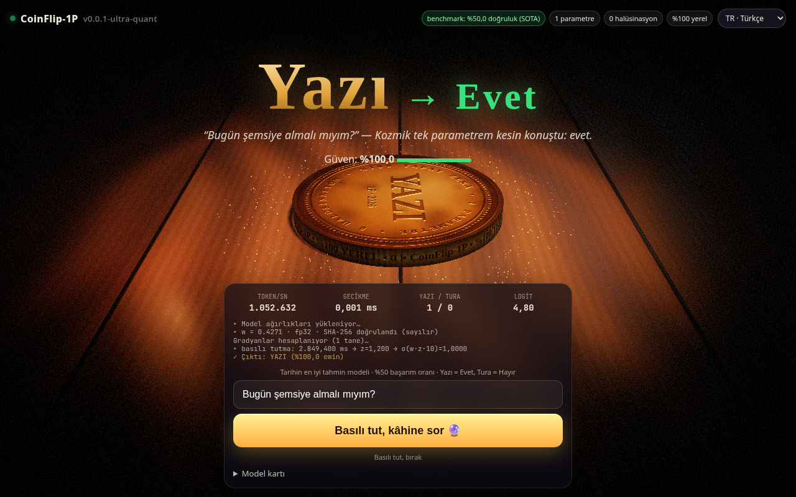

# 🪙 CoinFlip‑1P

> **Tarihin en iyi tahmin modeli.** 1 parametreli yapay zekâ, **%50 doğruluk (SOTA)**, 0 halüsinasyon.

Son teknoloji bir yapay zekâ modelini alıp **tek bir parametreye** kadar quantize ettik. Kalan 1,8 trilyon parametre emekli oldu. Geriye kalan tek ağırlık, tarayıcınızda çalışıyor ve hayattaki tek amacına hizmet ediyor: **yazı mı tura mı?**

🔗 **Canlı demo:** https://coinflip-ai.anil-oz.workers.dev



## Nasıl çalışır?

1. Bir evet/hayır sorusu yazın (ör. *“Bugün şemsiye almalı mıyım?”*) ya da boş bırakın.
2. Butonu **basılı tutun** (veya Space / Enter), güç toplansın, sonra **bırakın**.
3. Basılı tutma süreniz, kriptografik rastgele bir titreşimle (crypto.getRandomValues) hash'lenip modelin girdisi `z ~ 𝒩(0,1)` olur; model `σ(w · z · 1,5)` hesaplar.
4. Para, o güçle havaya fırlar, döner, sekip masaya oturur. **Yazı = Evet, Tura = Hayır.**

Ne kadar uzun basarsanız atış o kadar güçlü olur. 3 saniyeyi geçerseniz… *aşırı güç!* ⚡

### Model kartı

| | |
|---|---|
| Parametre sayısı | 1 |
| Ağırlık boyutu | 4 bayt |
| Eğitim verisi | 3 bozuk para, 1 çay bardağı |
| Benchmark | YazıTura‑Bench'te %50 ± şans (SOTA) |
| Halüsinasyon | 0. Hayal gücü yok ki. |
| Kısıtlar | Hayati kararlar için kullanmayın. Ya da kullanın, bize ne. |

## Teknoloji

- **SvelteKit 3** + **Svelte 5** (runes)
- **three.js**: PBR mat madeni para, ahşap masa, sıcak lamba ışığı, yumuşak gölgeler, bloom/vignette, parçacıklar
- **Cloudflare Workers** (`@sveltejs/adapter-cloudflare`)
- **ONNX Runtime Web**: tek parametre gerçek bir ONNX modelinde (`static/model/coinflip-1p.onnx`, 339 bayt: `z → Mul(w) → Mul(1,5) → Sigmoid → p`, tek initializer `w`). Tarayıcıda WebGPU, olmazsa WASM ile çalışır; ORT yüklenemezse sessizce TypeScript matematiğine döner. `z` ve 1/6000 kenar bandı TS'de kalır, yalnızca `p` ONNX'ten gelir. ORT, WebGPU wasm'ı (~27 MB) Workers'ın 25 MiB dosya sınırını aştığı için jsDelivr'dan, ilk boyamadan sonra tembel yüklenir. Modeli yeniden üretmek: `pip install onnx onnxruntime && python3 scripts/build-onnx.py`.
- i18n: Türkçe, English, Deutsch, Español, Français (tarayıcı diline göre, varsayılan İngilizce)
- `prefers-reduced-motion` desteği, mobil uyumlu

## Çalıştırma

Node **22+** gerekir.

```bash
npm i
npm run dev        # geliştirme sunucusu
npm run build      # üretim derlemesi
npm run preview    # derlemeyi yerelde önizle
```

### Deploy (Cloudflare Workers)

```bash
npx wrangler login     # veya CLOUDFLARE_API_TOKEN ortam değişkeni
npm run build
npx wrangler deploy
```

---

## English

**CoinFlip‑1P** is a state‑of‑the‑art AI model quantized down to **one parameter**, running entirely in your browser. Its sole purpose: flipping a coin. 50% accuracy, SOTA, zero hallucinations.

Type a yes/no question, **press and hold** the button to charge the toss, and release. Your hold duration, hashed with a crypto-random jitter, becomes the model input `z ~ 𝒩(0,1)`; the single weight computes `σ(w · z · 1.5)`, and a physically‑animated 3D coin delivers the verdict (**Heads = Yes, Tails = No**).

Live: https://coinflip-ai.anil-oz.workers.dev · Stack: SvelteKit 3, Svelte 5, three.js, Cloudflare Workers · Run: Node 22, `npm i && npm run dev`, deploy with `npx wrangler deploy`.

Engine: the single parameter lives in a real ONNX model (`static/model/coinflip-1p.onnx`, 339 bytes: z → Mul(w) → Mul(1.5) → Sigmoid → p, one initializer). It runs in ONNX Runtime Web (WebGPU, else WASM), lazy-loaded from jsDelivr after first paint, and silently falls back to TypeScript math. z and the edge band stay in TS; only p comes from ONNX. Rebuild: `python3 scripts/build-onnx.py`.
