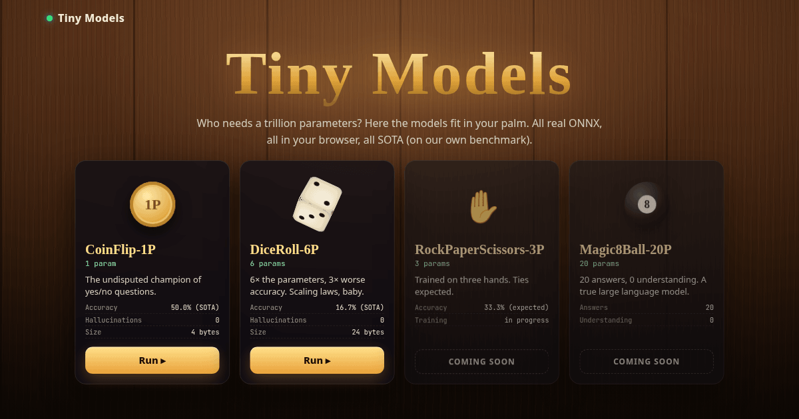

# 🪙🎲🎯 Tiny Models

> **Absürt derecede küçük yapay zekâ modelleri.** Trilyon parametre kimin umurunda? Burada modeller avuç içine sığar.

🔗 **Canlı:** https://tiny-models.anil-oz.workers.dev · (eski adres `coinflip-ai.anil-oz.workers.dev` buraya yönlenir)



| Model | Parametre | Doğruluk | Adres |
|---|---|---|---|
| 🪙 **CoinFlip‑1P** | 1 | %50,0 (SOTA) | [/coin](https://tiny-models.anil-oz.workers.dev/coin) |
| 🎲 **DiceRoll‑6P** | 6 | %16,7 (SOTA) | [/dice](https://tiny-models.anil-oz.workers.dev/dice) |
| 🎯 **Tavla‑1.6K** | 1.601 | rastgeleye karşı %99,7 · sezgisel bota karşı %75,3 | [/tavla](https://tiny-models.anil-oz.workers.dev/tavla) |
| ✊ RockPaperScissors‑3P | 3 | yakında | — |
| 🎱 Magic8Ball‑20P | 20 | yakında | — |

Her dil kendi adresinde: `/`, `/tr`, `/de`, `/es`, `/fr` (ve `/tr/coin`, `/tr/dice` …). İngilizce adreslere tarayıcı dili (Accept-Language) veya seçilen dil çereziyle gelen ziyaretçiler kendi dillerine yönlendirilir.

## Nasıl çalışır?

1. (İsteğe bağlı) bir soru yazın: *“Bugün şemsiye almalı mıyım?”* ya da *“Kaç saat uyumalıyım?”*
2. Butonu **basılı tutun** (veya Space / Enter), güç toplansın, sonra **bırakın**.
3. Basılı tutma süreniz kriptografik rastgele bir titreşimle (crypto.getRandomValues) hash'lenip modelin girdisi olur.
4. Model **gerçek bir ONNX dosyası** olarak tarayıcıda **ONNX Runtime Web** ile (WebGPU, olmazsa WASM) çalışır; yüklenemezse sessizce TypeScript matematiğine döner.

### CoinFlip‑1P
`z ~ 𝒩(0,1)` → `σ(w · z · 1,5)` · tek parametre `w` · `static/model/coinflip-1p.onnx` (`scripts/build-onnx.py`). **Yazı = Evet, Tura = Hayır.**

### DiceRoll‑6P
6 Gumbel gürültüsü `g` → `softmax((g + b) · 1,0)` · altı parametre `b` (hepsi 1/6, elle ayarlandı) · `static/model/diceroll-6p.onnx` (`scripts/build-onnx-dice.py`). Sonuç 1–6, güven = softmax maksimumu. Eşit bias'lar sayesinde her yüz tam olarak 1/6 olasılıklı (bkz. `npm test`).

### Tavla‑1.6K (gerçekten eğitilmiş!)
TD‑Gammon tarzı tavla (backgammon) ağı: Tesauro'nun 198 girdili kodlaması → 8 sigmoid gizli nöron → 1 sigmoid çıktı (hamleyi yapan oyuncunun kazanma olasılığı). **1.601 parametre** (198·8 + 8 + 8 + 1), ONNX 6,6 KB.

- **Eğitim:** `train/td.py`, saf numpy, TD(λ=0,7) kendine karşı oyun; 8 farklı ayar paralel 95 dk koşturuldu, seçilen model (α 0,2→0,02) **381.954 oyun** oynadı.
- **Değerlendirme** (`train/eval.py`, seçimden bağımsız tohumlarla 5.000'er oyun): rastgele oyuncuya karşı **%99,7** (4986/5000), pip sayan sezgisel bota karşı **%75,3** (3766/5000).
- **Kurallar:** `train/bg.py` (Python) ve `src/lib/tavla-engine.ts` (TS): bar'dan giriş, kırma, toplama, iki zarı da kullanma / büyük zar kuralı, çift zarlar. Katlama küpü yok. TS ve Python 1.500 rastgele pozisyonda birebir aynı yasal hamle kümesini üretir (`npm test`).
- **Tarayıcıda:** 1 hamle derinlik arama, tüm yasal hamleler tek `session.run` çağrısında puanlanır; ORT yoksa aynı ağırlıklarla TS'e döner. Tıkla‑oyna, yasal hedef vurgusu, canlı kazanma olasılığı çubuğu, akan yorumlar.
- 🤗 Hugging Face: [https://huggingface.co/hocestnonsatis/tavla-1.6k](https://huggingface.co/hocestnonsatis/tavla-1.6k) (ONNX, safetensors, eğitim kodu, örnek)
- Yeniden üret: `cd train && python3 td.py d 0.2 0.02 0.7 4 95`, sonra `python3 scripts/build-onnx-tavla.py train/best.npz`.

Coin ve dice'ta: 3D sahne (three.js, ahşap masa, lamba ışığı), LLM gibi token token akan yorumlar, sonucu kopyalama, 👍/👎 geri bildirim (RLHF parodisi), model kartı, 5 dil, `prefers-reduced-motion` desteği.

## Teknoloji

- **SvelteKit 3** + **Svelte 5**, **three.js**, **ONNX Runtime Web** (jsDelivr'dan tembel yükleme)
- **Cloudflare Workers** (`@sveltejs/adapter-cloudflare`), Cloudflare Web Analytics
- `redirect-worker/`: eski `coinflip-ai` Worker'ı, yeni adrese 301 yönlendirme

## Çalıştırma

Node **22+** gerekir.

```bash
npm i
npm run dev        # geliştirme sunucusu
npm test           # her iki modelin dağılım testleri (1e6 örnek)
npm run build && npx wrangler deploy
python3 scripts/build-onnx.py && python3 scripts/build-onnx-dice.py   # ONNX modellerini yeniden üret (pip install onnx onnxruntime)
```

---

## English

**Absurdly tiny AI models.** Who needs a trillion parameters? Live at https://tiny-models.anil-oz.workers.dev (the old `coinflip-ai.anil-oz.workers.dev` address redirects here).

- 🪙 **CoinFlip‑1P** (`/coin`): 1 parameter, `σ(w · z · 1.5)`, 50.0% accuracy (SOTA). Heads = Yes, Tails = No.
- 🎲 **DiceRoll‑6P** (`/dice`): 6 parameters (one bias per face, all 1/6), `softmax((g + b) · 1.0)` over Gumbel noise, 16.7% accuracy (SOTA). Answers 1–6; confidence = softmax max; exactly uniform faces (see `npm test`).
- 🎯 **Tavla‑1.6K** (`/tavla`): a *really trained* TD‑Gammon‑style backgammon net. Tesauro 198‑input encoding → 8 sigmoid hidden → 1 sigmoid (win probability): **1,601 parameters**, 6.6 KB ONNX. Trained by TD(λ=0.7) self‑play in pure numpy (`train/td.py`): 8 configs × 95 min in parallel on CPU, the shipped one played **381,954 games**. Held‑out eval, 5,000 games each: **99.7%** vs a random player, **75.3%** vs a pip‑count heuristic bot. Rules engine in Python (`train/bg.py`) and TS (`src/lib/tavla-engine.ts`), cross‑checked on 1,500 random positions (identical legal move sets); bar entry, hitting, bearing off, must‑use‑both / larger‑die, doubles; no doubling cube. In the browser: 1‑ply search, all legal moves scored in one ONNX `session.run`, TS fallback. 🤗 Model on Hugging Face: https://huggingface.co/hocestnonsatis/tavla-1.6k.
- ✊ RockPaperScissors‑3P and 🎱 Magic8Ball‑20P: coming soon.

Type an optional question, **hold** the button (or Space / Enter) and release. The hold duration, hashed with crypto‑random jitter, becomes the model input. Each model is a real ONNX file run by ONNX Runtime Web (WebGPU, else WASM), lazy‑loaded from jsDelivr, with a silent TypeScript fallback. Every language has its own URL (`/`, `/tr`, `/de`, `/es`, `/fr`, plus `/coin` and `/dice` under each).

Stack: SvelteKit 3, Svelte 5, three.js, ONNX Runtime Web, Cloudflare Workers. Run: Node 22, `npm i && npm run dev`, `npm test`, deploy with `npm run build && npx wrangler deploy`. Rebuild models: `python3 scripts/build-onnx.py && python3 scripts/build-onnx-dice.py`.
